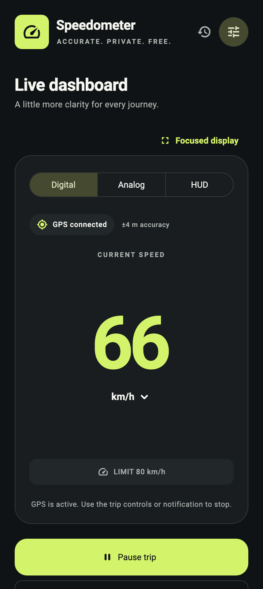
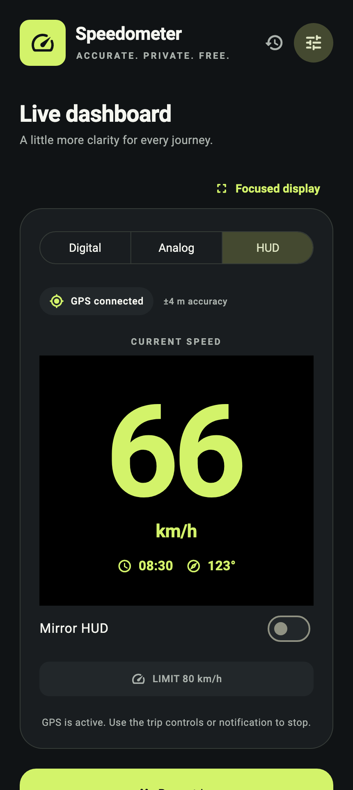
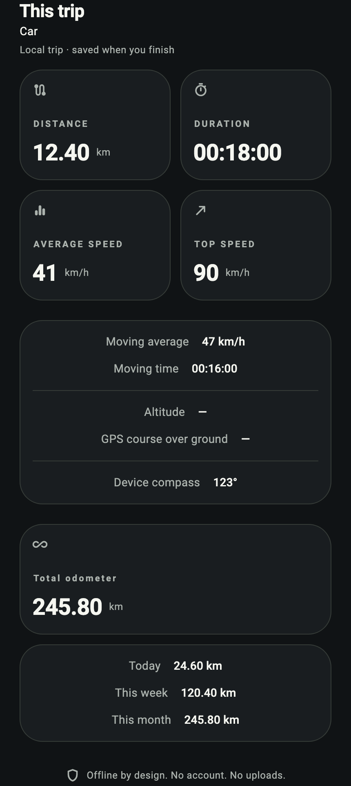
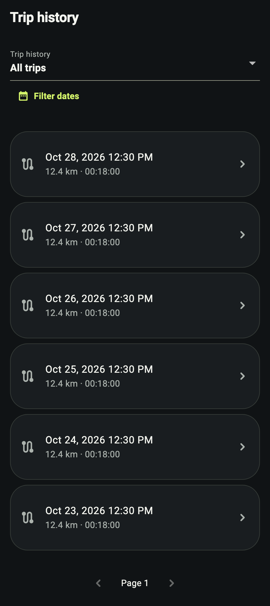
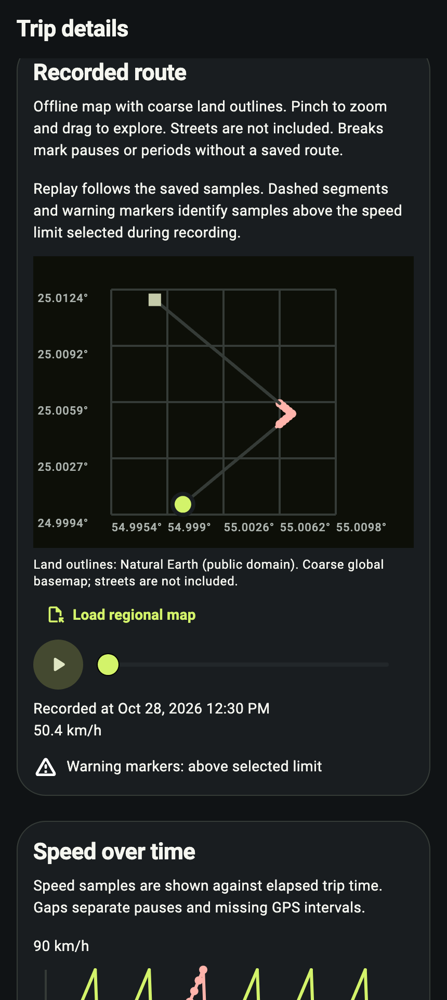
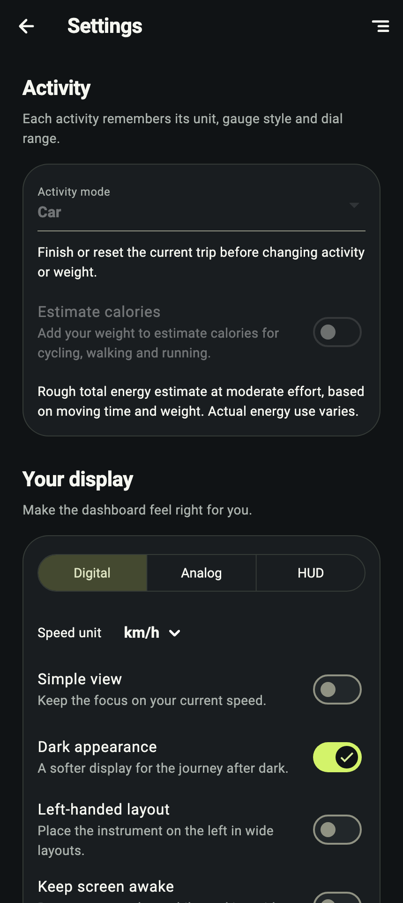

# Speedometer

A private, offline GPS speedometer for Android. No account, ads, backend,
telemetry, automatic location uploads or network maps.

**Project status:** The free-feature implementation is in place. Real-device GPS,
background behavior and battery acceptance remain pending, along with production
release preparation. See [project memory](PROJECT_MEMORY.md) for dated verification
evidence and [the plan](project_plan.md) for remaining work.

## Screenshots

Current Flutter screens rendered with synthetic speed and trip data. No personal
routes or live GPS data are used. Select an image to view it at full resolution.

| Digital speedometer | HUD display | Trip statistics |
| :---: | :---: | :---: |
| <a href="docs/screenshots/dashboard-digital.png"></a> | <a href="docs/screenshots/dashboard-hud.png"></a> | <a href="docs/screenshots/trip-statistics.png"></a> |
| **Trip history** | **Offline route replay** | **Settings** |
| <a href="docs/screenshots/trip-history.png"></a> | <a href="docs/screenshots/trip-route.png"></a> | <a href="docs/screenshots/settings.png"></a> |

[Capture notes and regeneration instructions](docs/screenshots/README.md).

## Features

- **Speed and instruments:** Doppler GPS speed with quality filtering and light
  jitter smoothing; km/h, mph, m/s and knots; digital, analog and HUD views;
  altitude, GPS course and a separate hardware compass.
- **Trip statistics:** distance, duration, moving time, average/moving-average/max
  speed, calibrated lifetime odometer and today/week/month totals stored in Drift.
- **Display and warnings:** mirrored/night HUD, ten accent colors, light/dark
  themes, configurable scales and handed layout, brightness and keep-awake;
  user-set speed limits with visual, sound, vibration and offline speech warnings.
- **History and maps:** saved trips, endpoints, speed graphs, map replay with
  over-limit segments, GPX/CSV export and summary sharing. The bundled Natural
  Earth basemap supports pan/zoom and shows coarse land outlines; see
  [map limitations](docs/offline_maps.md).
- **Android integration:** user-started foreground tracking, live speed
  notification with Stop, draggable/resizable overlay and a home-screen widget.
- **Activities and costs:** car, cycling, walking, running and boating modes,
  remembered instruments, optional calorie estimates and a local fuel/cost log.
- **Privacy and localization:** explicit local backup/restore and data deletion;
  English, Spanish, French, German and Arabic, including RTL layouts.

## Setup and run

Run commands from the project root. The checked-in CI configuration uses Flutter
**3.41.4 stable** and **JDK 17**. The Dart SDK requirement is **^3.11.1**; exact
dependency versions are in `pubspec.lock`.

Install the Flutter SDK, JDK 17 and Android SDK/tooling with API 36 support. Use an
Android device or emulator running **Android 7.0 / API 24** or newer; the app targets
**API 36**. Physical hardware is needed for GPS, sensors and background acceptance.

```sh
flutter doctor
flutter pub get
flutter devices
```

Resolve Android toolchain issues reported by `flutter doctor`; if licenses are
missing, run `flutter doctor --android-licenses`. Replace `DEVICE_ID` with an
Android ID from `flutter devices`:

```sh
flutter run -d DEVICE_ID
```

No API keys, backend configuration or map downloads are required to run the app.
Initial dependency resolution and build-tool downloads require network access;
the installed app works offline.

## Use the app

### Tracking

The first launch explains location use. Continue opens the dashboard without
starting GPS. **Start trip** requests precise foreground location. With
**Continue when minimized** enabled (the default), a user-started location
foreground service continues recording behind other apps or with the screen
locked. Its live speed notification has a Stop control. No background-location
permission is requested. Android 13+ also asks for notification permission; if
denied, stop tracking using the in-app trip controls or Android's active-app
control.

With **Continue when minimized** disabled, hiding the app pauses tracking and
requires an explicit resume. A recovered trip also opens paused. The optional
overlay requires a separate explained Android grant. Closing the overlay leaves
the trip running. A home-screen widget displays tracking state and only opens
the app; it never starts GPS.

Pause retains the current trip. With **Save trips automatically** enabled, Finish
saves it to history; with that setting disabled, Stop discards the trip record.
Reset also discards the current trip's history entry. These actions and deleting
an individual saved trip keep the lifetime odometer/calendar totals.

Duration and moving time use accepted fix timestamps and exclude pauses and GPS
loss. Unreliable speed is shown as unavailable. GPS course describes movement;
the separate hardware compass depends on an available, calibrated sensor. Speech
warnings need an installed offline voice for the selected language; the app does
not download voices. See [Android behavior](docs/android_platform.md).

### Focused display and settings

Tap **Focused display** on the dashboard for an uncluttered instrument. The selected
analog/digital/HUD style, units, warnings and HUD mirroring remain active. Pause
and Finish stay below the instrument, including in landscape. Use the exit button
to return; changing screens does not start or stop a trip. In Settings, the category
menu jumps directly to a section; **All settings** restores the complete list.

### Trip history and map detail

History supports local date-range and in-progress/finished filters. Previous/Next
browse 20 records at a time; Clear filters returns to the first unfiltered page.
Finish/reset preserve the paused trip and show a storage error when a final write
fails, allowing the action to be retried. Calendar totals refresh at local midnight
and when the app returns to the foreground.

In a trip's map, **Load regional map** accepts a local GeoJSON road-line layer with
source attribution. It remains in memory while that trip screen is open, without
network requests. It is not saved or included in backups/exports. The bundled map
remains available without an import. See [the format and limits](docs/offline_maps.md).

### Activity modes and fuel costs

In **Settings → Activity**, select car, cycling, walking, running or boating.
Each mode remembers its speed unit, gauge style and scale; boating initially
uses knots. Choose activity and optional body weight between trips: both remain
fixed while a trip is active, paused or recovered. Cycling/walking/running show
a rough calorie estimate when weight is enabled. Estimates use accepted moving
time and representative moderate-effort MET values, not heart rate, terrain or
measured power; actual energy use varies. See [the calculation](docs/adr/0002-local-tracking-activities-fuel.md).

In **Settings → Fuel and vehicle costs**, record fuel and the distance it covered,
or record a maintenance-only expense with fuel/distance zero. Entries can be
edited/deleted. Units support km/mi and L/US gallons. Consumption uses total fuel
divided by the matching logged distance; cost summaries stay separate for each
currency, without exchange rates. The mileage-log button opens trip history.
Fuel records do not modify GPS trip distance or the lifetime odometer.

### Privacy and local backups

**Save precise route** is enabled by default. Turn it off in Settings to retain
statistics and speed samples without saving new route coordinates. Existing
routes remain until deleted. The map leaves gaps across pauses, GPS loss and
periods when route storage is off. GPX exports include only saved coordinates.

Local backups include preferences, trips, routes, odometer and fuel/cost records.
Restore validates the document before replacing data and stops GPS first. Version
2 backups include fuel; older version 1 backups remain supported and contain no
fuel records. Export first if you need to keep the data being replaced. Files
can contain precise locations and optional weight; share them deliberately.

Android automatic cloud backup and device transfer are excluded for app data;
backup/restore is an explicit local-file action. **Delete all local data** stops
tracking and removes trips, routes, fuel/cost records, odometer and settings.
Previously exported files remain under your control.

## Validate

Run the same automated checks as [CI](.github/workflows/ci.yml):

```sh
dart format --output=none --set-exit-if-changed lib test integration_test
flutter analyze
flutter test --coverage
python3 -m unittest discover -s test/tool -p '*_test.py'
python3 tool/check_coverage.py
flutter build appbundle --release
```

For a debug APK or the deterministic Android integration flow:

```sh
flutter build apk --debug
flutter test integration_test/tracking_flow_test.dart -d DEVICE_ID
```

The debug APK is written to `build/app/outputs/flutter-apk/app-debug.apk`.
Coverage output is `coverage/lcov.info`. CI gates instrumented handwritten lines
at 85% overall, 90% domain, 85% data and 80% for the session controller; generated
code is excluded. Uninstrumented files and native Kotlin are outside this metric.

Unit, provider, widget and shared critical-flow tests use deterministic inputs
and fake platform boundaries. The Android integration entry point reuses the
host-tested disclosure/start/alert/background/pause/reset flow. It does not read
real GPS coordinates or prove hardware behavior. Follow
[the device checklist](docs/manual_testing.md) and
[native acceptance checks](docs/android_platform.md) for road/reference accuracy,
permissions, actual alert output, OEM background behavior and battery profiling.
Device checks still require recorded hardware evidence.

## Architecture and storage

The app follows feature-first Clean Architecture: presentation coordinates pure
Dart domain use cases, repositories hide storage/platform details, Riverpod manages
state and dependency injection, and GoRouter handles navigation.

- `lib/app`: composition, named routes, startup/disclosure guards and lifecycle.
- `lib/core`: themes, typed failures, platform boundaries and shared Drift database.
- `lib/features/speedometer`: validated GPS, durable session coordination and instruments.
- `lib/features/trips`: local trip repository, history, maps, replay and document export.
- `lib/features/activities`: pure mode selection, remembered instruments and calorie policy.
- `lib/features/fuel`: validated fuel/cost entries, local repository, summaries and UI.
- `lib/l10n`: five ARB sources; generated localizations live in `lib/generated/l10n`.
- `android/app/src/main/kotlin`: native tracking, notification, overlay, widget and device adapters.
- `test`: domain/data/provider/widget/golden/migration tests and shared app flows.
- `integration_test`: Android entry point for the shared deterministic tracking flow.

Drift schema v2 adds fuel records with a tested v1 migration preserving trips,
points and distance totals. Small display/activity settings remain behind
SharedPreferencesAsync; structured records live in SQLite.

### Generated code

Edit ARB sources and database definitions, then regenerate the affected output:

```sh
# After editing lib/l10n/*.arb:
flutter gen-l10n

# After editing Drift tables/database definitions:
dart run build_runner build
```

Never edit generated Dart by hand. Schema changes also require a versioned
migration, snapshots in `drift_schemas/` and migration tests.

## Project documentation

Before editing, read [rules.md](rules.md), [project_plan.md](project_plan.md) and
[PROJECT_MEMORY.md](PROJECT_MEMORY.md). Prepend each session's changes, checks,
limitations and next steps under the memory's work log, preserving earlier logs.

- [Current architecture decision](docs/adr/0002-local-tracking-activities-fuel.md)
- [Completion, focused display and local maps](docs/adr/0004-reliability-and-focused-display.md)
- [Dependency and license decisions](docs/dependencies.md)
- [Offline map attribution and limitations](docs/offline_maps.md)
- [Device acceptance checklist](docs/manual_testing.md)
- [Native Android behavior and acceptance checks](docs/android_platform.md)
- [Changelog](CHANGELOG.md)

Production release work remains pending: the application ID is currently
`com.example.speedometer`, and release builds use the debug signing key. Production
identity/signing, privacy-policy hosting/linking, crash reporting, store assets
and Play publishing are tracked separately in the plan. Premium and rare features
remain deferred until after free-app device acceptance.

GPS signal loss now clears stale readings while keeping an explicitly started trip
waiting for reception. Recovery begins a fresh statistics segment. Redundant GPS
registration and native redraw work are avoided; measured accuracy, battery drain
and OEM background acceptance remain pending. See
[the reliability decision](docs/adr/0003-gps-recovery-and-platform-work.md).
